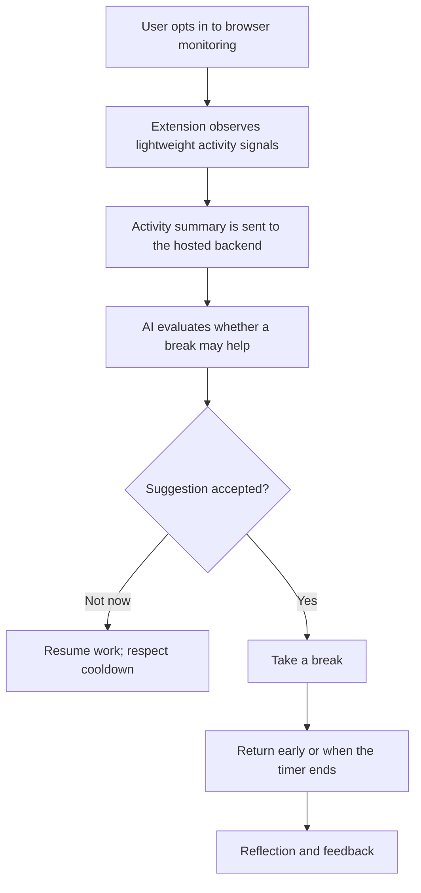

# TouchGrass 🌿

**An AI cognitive-reset companion for developers.**

TouchGrass watches for lightweight browser activity patterns that may indicate a developer is stuck in an unproductive loop, then asks an AI agent to evaluate whether a break might help. Instead of relying only on a rigid timer, it offers a contextual, user-controlled break—so developers can step away and return with a fresher perspective.

<p align="center">
  <a href="https://getoffcode.tech"><strong>🌐 Visit TouchGrass</strong></a>
  ·
  <a href="https://github.com/RishabhGupta949/GetOffCode-Hacktoberfest"><strong>💻 View Source</strong></a>
</p>

<!-- Add a hosted demo video or GIF here when available. -->

## The Problem

Developers can lose time in debugging loops, repeatedly switch tabs while searching for answers, and keep working long after their focus has faded. Traditional break timers often interrupt on a schedule without considering what the person is doing.

TouchGrass explores a different approach: use lightweight activity signals as context, let an AI agent evaluate whether a break may be useful, and leave the decision to the user.

## What It Does

- **Activity-aware suggestions:** Uses browser activity patterns, such as tab-switch frequency and active/idle signals, to identify moments worth evaluating.
- **AI-guided break recommendations:** Sends the relevant activity summary to the backend for AI evaluation and a contextual recommendation.
- **User stays in control:** Users can accept a suggestion or choose “Not now.” A suggestion does not automatically force a break.
- **Dedicated break experience:** A focused break page with a countdown and an early-return action.
- **Return reflection:** A lightweight return flow helps the user reflect on whether stepping away changed their perspective.
- **Demo mode:** A short trigger makes it easier to demonstrate the workflow without waiting through a long work session.

> TouchGrass is a productivity experiment, not a medical or mental-health diagnostic tool. Activity signals can suggest a pattern; they cannot prove that someone is struggling.

## How It Works



## Live Project

- **Website:** [getoffcode.tech](https://getoffcode.tech)
- **Source code:** [GitHub repository](https://github.com/RishabhGupta949/GetOffCode-Hacktoberfest)
- **Hosted API:** `https://touchgrass-api-vat6.onrender.com`
- **Extension download:** [Download TouchGrass](https://getoffcode.tech/downloads/touchgrass-extension.zip)
- **Youtube Video URL:** https://www.youtube.com/watch?v=ki9WYvnFCS4

The API is hosted on Render. End users should only need to install the browser extension; they should not need to install Python or run the backend locally. The hosted service may take longer to respond after inactivity if it is running on Render's free instance.

## Install the Extension

TouchGrass is currently distributed as an unpacked Chromium extension ZIP rather than through the Chrome Web Store.

1. Visit [getoffcode.tech](https://getoffcode.tech) and download the extension ZIP.
2. Extract the ZIP to a folder on your computer.
3. In Chrome, open `chrome://extensions`.
4. Turn on **Developer mode**.
5. Select **Load unpacked** and choose the extracted extension folder—the folder containing `manifest.json`.
6. Open TouchGrass from the browser toolbar and review the available monitoring controls and permissions.

The extension requests browser permissions needed for activity signals and extension behavior. Review the permissions before enabling monitoring.

## Architecture and Technology

| Component | Technology | Responsibility |
|---|---|---|
| Browser extension | Chrome Manifest V3, JavaScript, HTML, CSS | Activity signals, break UI, user interactions, and return flow |
| API backend | Python, FastAPI, Uvicorn | Receives activity summaries and coordinates application state and AI evaluation |
| State and cache | SQLite | Stores application state and related records according to the configured backend implementation |
| AI integration | OpenRouter API with a configurable open-weight model | Evaluates submitted context and supports break recommendations |
| Hosting | Render | Hosts the API backend and public landing page |
| Landing page | Static frontend build | Explains the product and distributes the extension package |

The backend's default model configuration is `nvidia/nemotron-3-ultra-550b-a55b:free`; actual availability depends on the model provider and account limits. AI provider credentials belong on the server and must not be embedded in the extension or public website.

## Privacy and User Control

TouchGrass is designed around lightweight activity signals rather than capturing the user's full work content. The extension uses browser permissions to observe activity-related events and sends relevant summaries to the hosted backend for evaluation.

Before enabling monitoring, users should review the extension's requested permissions. Do not treat TouchGrass as a monitoring or employee-surveillance tool. The project should disclose clearly that data sent to the hosted backend is processed by the backend and configured AI provider. Do not assume that requests are processed locally or that server-side records are never retained; those details depend on the deployed configuration and provider policies.

## Local Development

The hosted experience does not require end users to install Python. Python setup is only for contributors who want to run the backend locally.

### Requirements

- Python 3.12 recommended for compatibility with the pinned dependencies
- Node.js and npm if you want to work on the landing page
- An OpenRouter API key if you want to exercise live AI inference

### Run the backend locally

From the repository root:

```powershell
python -m venv .venv
.\.venv\Scripts\Activate.ps1
pip install -r backend/requirements.txt
$env:OPENROUTER_API_KEY = "YOUR_OPENROUTER_API_KEY"
python -m uvicorn backend.main:app --host 127.0.0.1 --port 8765
```

Keep secrets in environment variables or a local environment file excluded by `.gitignore`. Never commit API keys.

If you are testing the extension against the local backend, ensure your local extension configuration points to `http://127.0.0.1:8765`. The publicly distributed extension should use the hosted Render API URL instead.

### Run the landing page locally

```powershell
cd landing
npm install
npm run dev
```

For a production build:

```powershell
npm run build
```

The generated static output is expected in `landing/dist`.

### Tests

From the repository root, install the backend requirements and run:

```powershell
pytest
```

## Open-Weight AI and Open Innovation

Using an open-weight model makes the AI layer more adaptable: the model can be changed as project needs evolve, without rebuilding the browser experience around a single proprietary model. Keeping the provider integration behind the FastAPI backend also separates the extension from model-specific API details.

TouchGrass currently uses hosted inference through OpenRouter; it does **not** claim to run inference fully offline or keep every piece of activity data on the user's device. The open-weight approach is about model choice and adaptability, while the hosted architecture makes the extension simpler for end users to install.

## Hacktoberfest Challenge

Built for the [Hacktoberfest Open-Source AI Challenge — Week 1: Touch Grass](https://dev.to/challenges/hacktoberfest-week1-2026-10-05).

The project explores whether AI can help developers notice unproductive work patterns and make it easier to step away from the screen for a while.

## Contributing

Issues and thoughtful contributions are welcome. When contributing:

1. Explain the problem or proposed improvement.
2. Keep changes focused and avoid committing credentials, local databases, logs, or user data.
3. Run relevant tests before opening a pull request.
4. Be explicit about behavior that has not been tested in a real browser.

## License

<!-- Add the repository's actual license and link here before inviting reuse. Do not claim an open-source license unless a LICENSE file is present. -->

---

<p align="center"><strong>Step away. Come back clearer. 🌿</strong></p>
